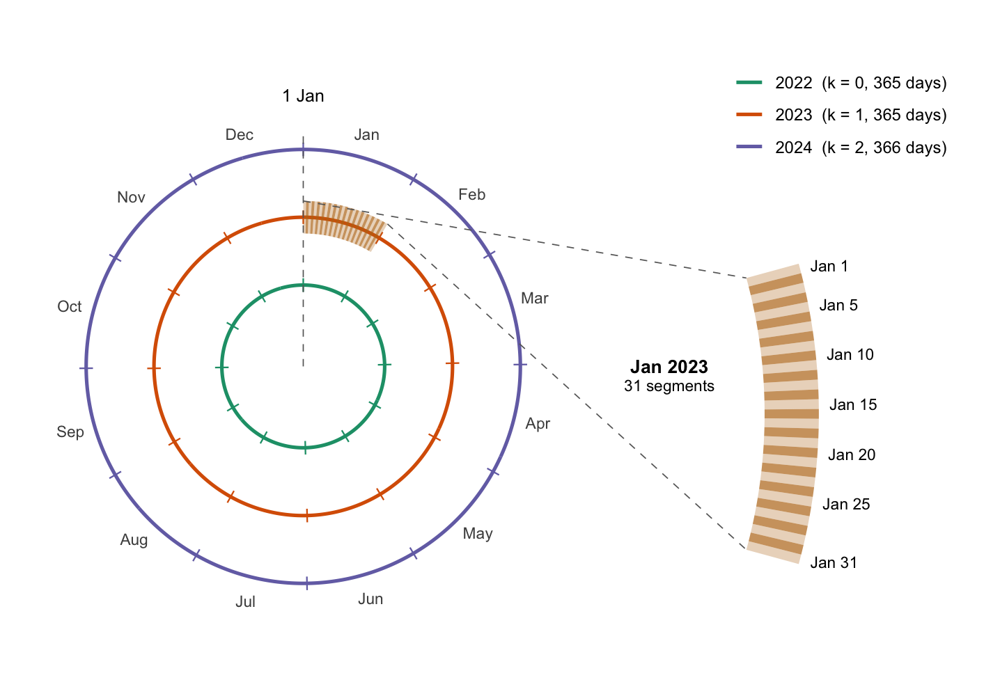
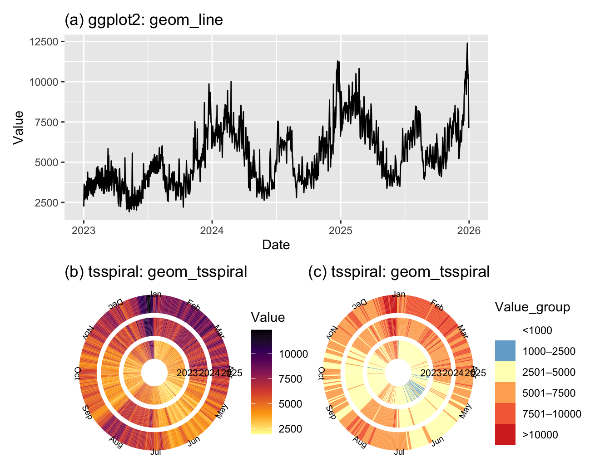

---
# Example from https://joss.readthedocs.io/en/latest/submitting.html
title: 'tsspiral: An R Package to Create Circular Version of Time Series Plots'
tags:
  - missing values
  - forecasting
  - daily series
  - visulisation
  - seasonal patterns
  - polar coordinates
authors:
  - name: Thiyanga S. Talagala
    orcid: 0000-0002-0656-9789
    affiliation: "1" 
affiliations:
 - name: Department of Statistics, Faulty of Applied Sciences, University of Sri Jayewardenepura, Sri Lanka 
   index: 1
citation_author: Talagala, Thiyanga. S. (2026).
date: 19 October 2026
year: 2026
bibliography: paper.bib
output: rticles::joss_article
csl: apa.csl
journal: JOSS
---

# Summary

 `tsspiral` is an open-source R package that introduces a circular approach to time series visualisation using polar coordinates.  We refer to this circular representation of time series data as a spiral.  `tsspiral` provides a collection of `ggplot2` geometries for creating a spiral representation of time series data. In our approach, we arrange observations around a circle.  Each year is represented by a circle, with the angular position corresponding to the day of the year, and successive years appear as concentric rings. This arrangement facilitates the exploration of periodicity, seasonality, and recurring temporal patterns, particularly in long time series. The package also supports temporal hierarchical visualisations to compare patterns across time scales. By bringing polar-coordinate-based visualisation into routine time series analysis, `tsspiral` offers a practical tool for exploring temporal patterns and communicating complex time-dependent structures. Rather than treating spiral plots as standalone graphics, our approach brings them into the grammar of graphics framework, enabling users to explore temporal patterns through a broader range of visual encodings. 

# Statement of need

Time series visualization is an essential step in time series analysis, forecasting, imputation, anomaly detection etc. Time series data are commonly visualized using Cartesian coordinate plane, where time is represented along the horizontal axis ($x$) and observed values along the vertical axis ($y$). Although conventional time series plots are effective for identifying important temporal features, such as trends, seasonal patterns, sudden shifts, and irregular fluctuations, identifying these features can become challenging with long time series, particularly daily observations spanning several years or decades. As the length of the series increases, the visual representation becomes increasingly dense, making it difficult to recognize recurring patterns, compare corresponding periods across years and identify changes in seasonal behavior. 


Circular representations of time series provide an alternative visualisation in which time is mapped to angular position and successive years are arranged as concentric rings. This representation facilitates visual comparison of corresponding time periods across years, making recurrent patterns, unusual events, temporal changes, and missing data gaps easier to explore. Furthermore, conventional time series plots make it difficult to visualise nested temporal structures and compare seasonal patterns across different levels of the temporal hierarchy.   In addition, traditional time series plots can make categorical time series data hard to visualise. Spiral time series plots help address these limitations.

Spiral plots support visualising long time series and better identifying periodic structures in the data [@weber2001visualizing; @rakuschek2026guided]. John W. Tukey emphasized, “Exploratory data analysis is an attitude, a state of flexibility, a willingness to look for those things that we believe are not there, as well as those we believe to be there”[@tukey1977exploratory]. Guided by this philosophy, exploring alternative visualizations of time series data encourages us to move beyond familiar representations and discover patterns that might otherwise remain hidden. Spiral layout has two major advantages for visualizing time series data: i)  able to visualize data with long axes, which greatly improves the resolution of visualization and space; ii) efficient for time series data to reveal
periodic patterns [@spiralize].

Since most statistical software packages readily support line plots, their convenience and widespread availability have made line plots the conventional choice for visualizing time series. As a result, other forms of visualization have received comparatively less attention, despite their potential to reveal recurring and circular patterns in time series data.  Furthermore, creating spiral time series plots often requires custom code and careful handling of time series data. `tsspiral` fills these gaps.


# State of the field

@carlis1998interactive is one of the early contributions that introduced arranging data in a spiral. The authors mentioned that spirals provide
the user with easy visual cues to both serial and periodic
aspects of the data. @weber2001visualizing proposes spiral graphs for visualizing long time-series data sets and identifying periodic structures. It also discusses visualizing nominal and quantitative time series data. The R package `spiralize`[@spiralize] provides tools for visualizing time series data using spiral layouts. Our package introduces a new set of geoms that integrate with `ggplot2` [@ggplot2], extending the grammar of graphics to spiral-based visualization. This integration lets users build spiral plots with a familiar, flexible syntax while retaining the layered approach to data visualisation that makes `ggplot2` powerful. 


# Software design

The central idea of `tsspiral` is to transform a linear time series into a sequence of annual circular representations. Each year occupies a separate ring. Each year has 365 segments, while a leap year has 366. Concentric rings represent successive years. The angular coordinate represents an observation's position within its corresponding calendar year. 


Let \(t\) denote a date and \(y_t\) its associated observation. The number of days in year $X$ is defined as 

$$
D_X =
\begin{cases}
366, & \text{if }X\text{ is a leap year},\\
365, & \text{otherwise}.
\end{cases}
$$


Each annual ring is divided into \(D_X\) equal angular segments, where \(D_X\) represents the number of days in calendar year \(X\).  Each segment corresponds to one calendar day. We places January 1 at the top of each annual ring, with subsequent days progressing clockwise. The angular width of each segment is therefore

$$
\Delta\theta_X = \frac{2\pi}{D_X}.
$$

Consequently, each annual ring completes exactly one full revolution. The radial coordinate identifies the year, with each successive year assigned to a new concentric ring. It can be expressed as
$$
r_t = r_0 + k\Delta r,
$$

where $r_0$ is the radius of the innermost ring, $\Delta r$ is the radial distance between consecutive annual rings, and $k$ is the zero-based index of the year relative to the starting year.

For a date $t$ belonging to calendar year $X$, let $d_t$ denote its day-of-year index, where January 1 corresponds to $d_{t}=0$. The angular coordinate is then defined as
$$
\theta_t = \frac{2\pi d_{t}}{D_X}.
$$

Thus, the polar coordinates of an observation $y_t$ are

$$
(r_t,\theta_t)=
\left(
r_0+k\Delta r,\,
\frac{2\pi d_t}{D_X}
\right).
$$
Figure 1  shows the graphical representation of the construction of spiral plots using the `tsspiral` package.

<!--Each circle is split in to 365. For a leap year circle is divided in to ,,segments. When visualising quarterly data all dates corresponds to that is colour. -->

```{r , echo=FALSE}
#| label: fig-f1
#| out.width: "100%"
#| fig.cap: "Graphical representation of the construction of spiral plots using the tsspiral package. Each year is represented by a circular ring, with the angular position corresponding to the day of the year. Successive years are arranged as concentric rings, allowing examination of temporal patterns across years."
library(knitr)

```

The package provides three main geometries. They are listed as follows: 

i. Spiral time series geometry (`geom_tsspiral()`): The primary geometry transforms time series observations into a spiral layout. Each year is represented by a separate ring, and observations are positioned according to their temporal locations. The geometry supports visualizing daily, weekly, monthly, quarterly and annual observations. For lower-frequency observations, the corresponding temporal intervals are expanded to daily positions, allowing observations to occupy the appropriate calendar regions. For example, for monthly data, the January value is represented by colouring the segments corresponding to January 1 to January 31 using the January value. The `ring_spacing` argument controls the separation between annual rings. Calendar labels are displayed around the outermost ring.

ii. Spiral bar geometry (`geom_tsspiralbar()`): This geometry represents time series observations using bars instead of coloring the segment according to its value. The angular position identifies the temporal location, while the radial extent of each bar represents the magnitude of the corresponding observation. This representation is useful when comparing the magnitude and seasonal distribution of observations across multiple years.

iii. Missing value representation geometry (`geom_tsspiralmiss()`): The missing segments of the time series are represented by coloring the missing segment in black. It enables users to identify periods of incomplete data collection and examine whether missingness is concentrated within particular calendar periods or years.

In addition to these geometries, `tsspiral` provides two further functions:

- `temporal_hierarchical()`: represents daily, weekly, monthly, quarterly and annual summaries using aligned concentric rings. This enables the examination of temporal hierarchical patterns at multiple resolutions within a common coordinate system.

- `calendar_hourly_polar()`: creates a monthly calendar in which each day contains a 24-hour polar bar chart, allowing intra-day patterns to be examined while retaining calendar context.

Together, these functionalities provide a collection of complementary approaches for exploring temporal structures at different resolutions.


Figure 2 shows an example illustration. Figure 2 (a) shows the time series plot of daily tourist arrivals to Sri Lanka from 2023 January 1 to 2025 December 31. The corresponding data set is available in the `tsspiral` R package. This time series plot helps us to understand the overall behavior of the data across the full time span. We can see a clear upward trend and a seasonal behavior in the data. But through the line time series plot, it is difficult to answer the questions: i) 1. When is Sri Lanka busiest? ii). When is it quiet? iii). Are there predictable peaks and troughs throughout the year? iv). Which months or seasons attract more visitors?
v). Do certain days or periods consistently rank among the busiest? vi). Are there recurring days with lower arrivals that could be used for maintenance, conservation, or quiet operations?
vii) . How do recurring seasonal patterns differ across years—for example, between January 2023, January 2024, and January 2025?. The same time series plotted using the `geom_tsspiral` are shown in Figure 2-b and Figure 2-c. Figure 2-b shows the numerical values, and Figure 2-c shows the categorised values. The spiral version makes it easy to answer our question. For example, we observe peaks every year from July to August and from late November to January of the next year. Arrivals are low in May every year, which we can use for maintenance, conservation, or quiet operations.


```{r , echo=FALSE}
#| out.width: "100%"
#| out.height: "90%"
#| fig.cap: "Illustration example using Sri Lanka daily tourist arrival data. (a) time series plot using geom\_point, (b) spiral version of plot representing numeric values, (c) spiral version of the plot representing categorical values. Every year tourist mostly arrive in July- August and from December to January of the next year."

```


# Research impact statement

`tsspiral` expands the ways researchers can explore time series through a circular shape. By representing time series in
polar coordinates, the package provides an alternative way to explore temporal patterns, recurring cycles and changes over time. Furthermore,
this allows visualisation of temporal-hierarchical time series. By aggregating time series under different temporal scales from years to quarters, months, weeks, and days, spiral visualizations can
reveal recurring seasonal patterns and relationships between different temporal scales. This allows researchers to explore patterns in the time series
within and across years, quarters, months, or other time intervals. The package `tsspiral` provides one stop shop for visualizing time series series data in circular arrangement. @rakuschek2026guided pointed out that circular time-series plots have both advantages and disadvantages. Hence, @rakuschek2026guided suggested using both line and circular versions of the plots to better understand the data, rather than using circular plots as a replacement for line plots.

# AI usage disclosure

The software project presented in this paper accepts contributions that have been created with
the help of AI tools. ChatGPT
was used to assist with code efficiency improvement and documentation roxygen files writing.  Contributors are responsible for reviewing all AI-generated content and
ensuring its correctness and maintainability.  AI tools were used to improve the readability of this paper and to check spelling and grammar. 

### Reproducibility

The R package required to reproduce the results presented in this paper is available from CRAN and GitHub at [https://github.com/thiyangt/tsspiral](https://github.com/thiyangt/tsspiral). The complete R scripts and supporting code used to generate the results, figures, and tables are also available at the same repository. These resources enable readers to reproduce the analyses and visualizations presented in the paper.

# References
